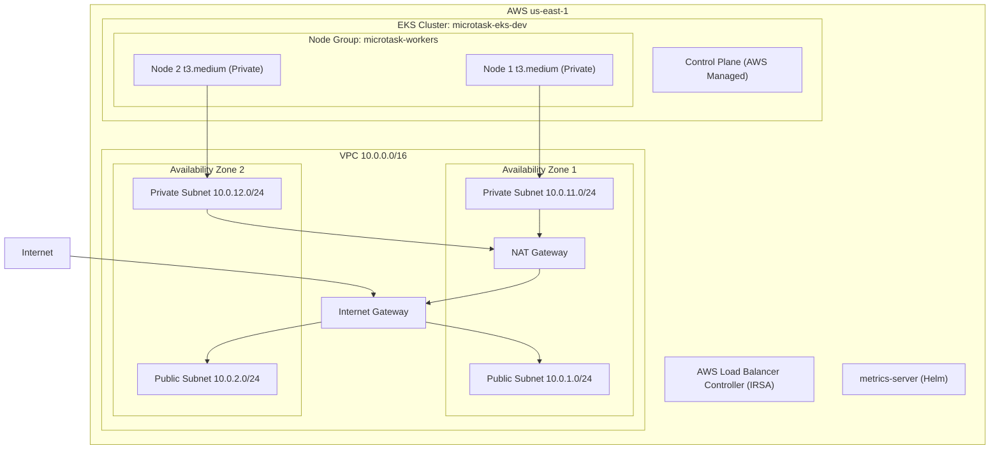

# MicroTask — Phase 1 Terraform Infrastructure

This directory provisions the AWS infrastructure for the MicroTask capstone project.

## Architecture



## Directory Structure

```
infrastructure/terraform/
├── versions.tf                    # Pinned provider versions
├── providers.tf                   # AWS, Kubernetes, Helm provider config
├── variables.tf                   # All input variables
├── locals.tf                      # Computed values and common tags
├── main.tf                        # Module wiring
├── outputs.tf                     # Important infrastructure values
├── terraform.tfvars.example       # Safe example — copy to terraform.tfvars
└── modules/
    ├── vpc/                       # VPC, subnets, IGW, NAT, route tables
    ├── eks/                       # EKS cluster, node group, OIDC, add-ons
    ├── load-balancer-controller/  # IAM role + service account for LBC
    └── metrics-server/            # metrics-server Helm release
```

## Prerequisites

1. AWS CLI installed and configured
2. Terraform >= 1.5.0 installed
3. kubectl installed
4. Helm installed

## Step 1 — Configure AWS credentials

```powershell
# Verify your AWS identity
aws sts get-caller-identity

# If not configured, run:
aws configure
# Enter: Access Key ID, Secret Access Key, Region (us-east-1), Output (json)
```

## Step 2 — Create terraform.tfvars

```powershell
cd infrastructure\terraform
copy terraform.tfvars.example terraform.tfvars
# Edit terraform.tfvars with your values (defaults work for dev)
```

## Step 3 — Initialize Terraform

Downloads all provider plugins and modules. Safe to run multiple times.

```powershell
terraform init
```

## Step 4 — Validate configuration

```powershell
terraform validate
```

## Step 5 — Format check

```powershell
terraform fmt -recursive
```

## Step 6 — Plan (review before applying)

Shows exactly what will be created. NO AWS resources are created yet.

```powershell
terraform plan -out=tfplan
```

Review the plan carefully. Expected resources: ~50-60.

## Step 7 — Apply (creates AWS resources)

**Only run this when you are ready. This will incur AWS costs.**

```powershell
terraform apply tfplan
```

Takes approximately 15-20 minutes (EKS cluster creation takes the longest).

## Step 8 — Configure kubectl

```powershell
aws eks update-kubeconfig --region us-east-1 --name microtask-eks-dev
```

Or use the Terraform output:
```powershell
terraform output configure_kubectl
# Copy and run the command it prints
```

## Step 9 — Verify nodes

```powershell
kubectl get nodes
kubectl get nodes -o wide
```

Expected: 2 nodes in Ready state.

## Step 10 — Verify system pods

```powershell
kubectl get pods -n kube-system
```

Expected: coredns, kube-proxy, vpc-cni, metrics-server all Running.

## Step 11 — Install AWS Load Balancer Controller

The IAM role and service account are created by Terraform.
Install the Helm chart manually after the cluster is ready:

```powershell
# Get the role ARN from Terraform output
terraform output load_balancer_controller_role_arn

# Add the Helm repo
helm repo add eks https://aws.github.io/eks-charts
helm repo update

# Install the controller
helm install aws-load-balancer-controller eks/aws-load-balancer-controller `
  -n kube-system `
  --set clusterName=microtask-eks-dev `
  --set serviceAccount.create=false `
  --set serviceAccount.name=aws-load-balancer-controller `
  --set region=us-east-1 `
  --set vpcId=$(terraform output -raw vpc_id)

# Verify
kubectl get deployment -n kube-system aws-load-balancer-controller
```

## Step 12 — Verify metrics-server

```powershell
kubectl top nodes
kubectl top pods -A
```

## Cost Breakdown (us-east-1, approximate monthly)

| Resource | Cost |
|----------|------|
| EKS Control Plane | $0.10/hour = ~$73/month |
| 2x t3.medium nodes | $0.0416/hour each = ~$60/month total |
| 1 NAT Gateway | $0.045/hour + $0.045/GB = ~$32/month |
| 2x EBS volumes (20GB) | $0.10/GB = ~$4/month |
| CloudWatch Logs | ~$2-5/month |
| **Total estimate** | **~$170/month** |

> **Important:** Stop costs by running `terraform destroy` when not using the cluster.
> EKS charges $0.10/hour even when idle.

## Destroy infrastructure

```powershell
# This permanently deletes ALL resources including data
terraform destroy
```

**Before destroying:**
- Uninstall all Helm releases from the cluster
- Delete any LoadBalancer services (they create AWS load balancers outside Terraform)
- Delete any PVCs (they create EBS volumes outside Terraform)

## Troubleshooting

**Nodes not joining the cluster:**
```powershell
kubectl get nodes
kubectl describe node <node-name>
aws eks describe-nodegroup --cluster-name microtask-eks-dev --nodegroup-name microtask-workers
```

**kubectl connection refused:**
```powershell
aws eks update-kubeconfig --region us-east-1 --name microtask-eks-dev
kubectl cluster-info
```

**Terraform plan fails with credentials error:**
```powershell
aws sts get-caller-identity
aws configure list
```

**Pods stuck in Pending:**
```powershell
kubectl describe pod <pod-name> -n <namespace>
kubectl get events -n <namespace> --sort-by='.lastTimestamp'
```
